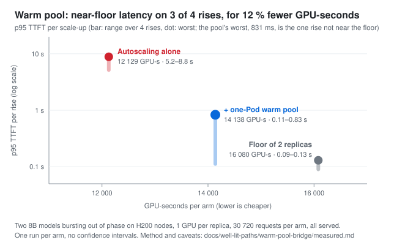
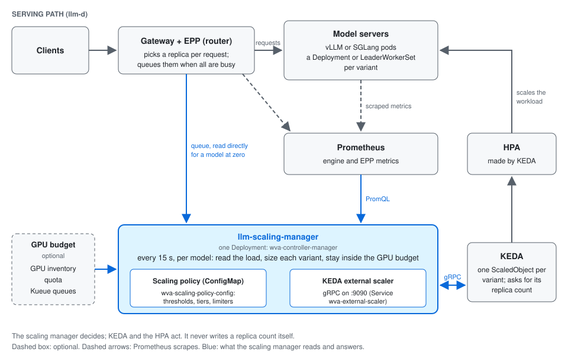

# llm-scaling-manager

[](LICENSE)
[](https://github.com/ev-shindin/llm-scaling-manager/actions/workflows/ci-pr-checks.yaml)
[](go.mod)

llm-scaling-manager sizes every LLM model by the work its replicas can
actually serve, keeps the fleet inside a GPU budget when you declare one
(opt-in; off by default), and lets KEDA do the scaling. An optional warm pool
of sleeping models covers the minutes a new replica takes to load.

**Sub-second p95 time to first token on every scale-up (two models bursting out
of phase), for 12 % less GPU than a spare-replica floor and 17 % more than
none.** (One run per arm, two 8B models on H200, a one-Pod warm pool:
[measured](docs/well-lit-paths/warm-pool-bridge/measured.md).)

llm-d has deprecated its workload-variant-autoscaler (WVA): `v0.9.0` is the
final release, and users are told to migrate to KEDA + EPP. llm-d says that
path covers WVA except cost-aware placement across variants, and that
deployments needing that, or fair sharing of a scarce accelerator pool, should
*"stay on WVA for now"*. This project is one way to do that: an independently
developed, advanced fork of WVA, still maintained, not affiliated with or
endorsed by llm-d. It is not upstream WVA: its actuation is a KEDA external
scaler. Kubernetes objects, make targets and metrics keep their `wva-` /
`wva_` names. ([KEDA alone, compared](docs/comparison/keda-alone.md);
[what is different from upstream](#what-is-different-from-upstream).)

**Choose it** for several models or variants under one GPU budget. **Stay on
llm-d's KEDA recipes** for one model, one GPU type, or a latency-SLO target
([where KEDA alone is enough](docs/comparison/keda-alone.md#where-keda-alone-is-enough)).
Kueue quotas, P/D and quota sharing are experimental. Variant choice is
unit-tested; an end-to-end proof and a two-GPU-type benchmark are on the
roadmap ([#142](https://github.com/ev-shindin/llm-scaling-manager/issues/142)).

**[Why llm-scaling-manager](docs/why.md)** (the case, costs and maturity) ·
**[Get started](docs/README.md#getting-started-in-three-steps)** ·
**[Pick your scenario](docs/well-lit-paths/)**

## Measured on GPU clusters

Single runs unless noted; each link has the method and caveats.

- **Scale-ups at near-floor latency on 3 of 4 rises.** With a one-Pod warm
  pool, p95 time to first token per rise falls from **5.2–8.8 s to
  0.11–0.83 s**: within 50 ms of a two-replica floor on three rises, 831 ms
  against the floor's 127 ms on the fourth. It uses **12 % fewer GPU-seconds**
  than that floor and 17 % more than no pool
  ([warm pool, measured](docs/well-lit-paths/warm-pool-bridge/measured.md)).
- **It prices the request shape, not just the queue** (experimental P/D path).
  Qwen3-0.6B at a constant 6 req/s, with a tuned HPA (180 s scale-down window,
  50 % per 120 s), build `f5f98761` of 2026-09-23. Through the first phase it held
  two decode replicas at 5–15 % KV-cache use. A KV threshold would have read
  that as one replica; that is computed, not a measured arm, and llm-d's default
  running-request trigger would likely have ordered more (also unmeasured).
  About four minutes after the request shape changed, once the new shape's
  throughput was measured, it ordered a third (KV peaked at 62 %), and no queue
  formed. On a second exposure, with both shapes already seen, p95 TTFT was
  **155 ms with 0 errors in 13 288 requests**; a cold controller reached a
  3.9 s p99 ([P/D path, measured](docs/well-lit-paths/pd-disaggregation/measured.md);
  [known gaps](docs/why.md#known-gaps)).
- **A warm Pod switches models in about 437 ms**, against about 41 s for a
  cold start (the engine switch itself: four switches of 435–440 ms on an H100
  test cluster). In the benchmark above, the lend waits for the scale-up
  decision: the bridge was first seen lent 33–143 s after each traffic rise
  ([warm pool](docs/well-lit-paths/warm-pool-bridge/)).



## Models and variants

A **model** is what a client asks for by name. A **variant** is one way of
serving it: a GPU type, a serving configuration (tensor parallelism, batch
size, quantization), or a role such as prefill or decode. Each variant is one
KEDA ScaledObject plus the workload it scales. Variants whose triggers name the
same `modelID` are sized together. Creating the ScaledObject is the whole
registration.

## Key features

- **Scaling from real load**: replica counts follow KV-cache use, queues and
  token throughput, per model and across its variants.
- **Cost-aware variant choice**: it grows the variant with the lowest cost per
  unit of capacity (`variantCost`).
- **A GPU budget** (opt-in): the GPUs that are free, a per-namespace quota, or
  Kueue's quotas (**experimental**).
- **Scale to zero and back**: KEDA's own scale to zero. The controller polls
  the router queue every 100 ms and pushes activation without waiting for
  KEDA's poll.
- **Warm-pool bridging** (opt-in): keep models loaded and asleep, and lend one
  while a variant's own replica starts.
- **Prefill/decode roles** and **sharing one quota between models**
  (both **experimental**).

## Installing

```bash
export NAMESPACE=<the namespace running llm-d>

make check-prereqs                    # read-only: tools, namespace, Prometheus
make setup-prereqs                    # ONCE per namespace, by a cluster admin
make deploy-wva                       # the controller — no cluster-scoped rights
make workload-patch                   # writes a patch (drain hook, weights, engine cache); apply it through your model-server chart
make scaledobjects-plan               # list your model servers; nothing is applied
make scaledobjects-apply              # register them — this is what makes it scale
```

Before you start:

- [ ] KEDA is on the cluster (on Kubernetes, `KEDA_HELM_INSTALL=true` installs
  it; on OpenShift, use the platform's KEDA).
- [ ] The router (EPP) runs with `featureGates: [flowControl]` in its
  EndpointPickerConfig; `make check-prereqs` refuses the install when it sees
  the gate off.
- [ ] Prometheus is on the cluster (it is installed if there is none).

A cluster admin runs `setup-prereqs` once per namespace; the namespace owner
runs the rest, and every later upgrade. If you are both, `make deploy-wva` does
the two in one command. An upgrade that adds a prerequisite needs the admin's
step again first ([upgrading](docs/reference/upgrade-and-uninstall.md#upgrading-from-before-v0100-rc1)).

The last two steps are not optional: a **KEDA ScaledObject** is how a workload
registers. Until one exists, the controller runs and scales nothing.

**On a shared cluster**, have a cluster admin run the controller out of the
tenant's reach: `WVA_NS=wva-<ns> WVA_WATCH_NS=<ns>` on `setup-prereqs` and
`deploy-wva` ([cluster-admin setup](docs/guides/admin-cluster-setup/README.md#keeping-the-controller-out-of-the-tenants-reach)).
The tenant then registers with
`NAMESPACE=<ns> make scaledobjects-plan WVA_NS=wva-<ns> WVA_WATCH_NS=<ns>`, and
the same for `scaledobjects-apply`, so every trigger names the controller in
`wva-<ns>`. Either way, the bound that holds is a GPU
ResourceQuota on the namespace
([bound the namespace's GPUs at admission](docs/guides/admin-cluster-setup/README.md#bound-the-namespaces-gpus-at-admission)).

| Then | |
| --- | --- |
| Pick a scenario; each links its guide | [well-lit paths](docs/well-lit-paths/) |
| Full install guide | [deploy/](deploy/) |
| Run it day to day | [operations.md](docs/reference/operations.md) |
| Watch what it decides | [monitoring.md](docs/reference/monitoring.md) |
| Make a workload scalable | [workload-preparation.md](docs/reference/workload-preparation.md) |
| Bridge a slow scale-up | [warm-pool/](docs/guides/warm-pool/) — opt-in; a pool holds accelerators |

## How it works



1. It learns which workloads it manages **from KEDA's calls**: it does not list
   or watch workloads. Being called is being managed, and the trigger
   `metadata` is the per-workload configuration.
2. It reads request rates and server performance from Prometheus.
3. Its capacity model (KV-cache use, queue depth, token throughput) decides the
   replica count each model needs, across all its variants and within any GPU
   budget you declared.
4. It returns that count to KEDA over the external-scaler gRPC contract. KEDA
   owns the HPA; llm-scaling-manager never writes the scale subresource.

More: [how the scaling manager fits together](docs/concepts/architecture.md),
[concepts](docs/concepts/), and the [docs](docs/) index.

## Example

```yaml
apiVersion: keda.sh/v1alpha1
kind: ScaledObject
metadata:
  name: llama-8b-scaler
  namespace: llm-inference
spec:
  scaleTargetRef:
    apiVersion: apps/v1
    kind: Deployment
    name: llama-8b
  pollingInterval: 5
  minReplicaCount: 1        # 0 to allow scale to zero
  maxReplicaCount: 10
  triggers:
  - type: external-push     # push: wakes a parked workload immediately
    name: wva-external-scaler
    metadata:
      scalerAddress: wva-external-scaler.<controller-namespace>.svc:9090  # your NAMESPACE on a namespace install
      modelID: meta/llama-3-8b   # required — the only field you must supply
      scalingPolicy: interactive # optional — a tier you add to the scaling policy; none ship enabled
      variantCost: "10.0"        # optional — defaults to "10.0"
    authenticationRef:      # TLS, the default. Plaintext install: ...svc.cluster.local:9090 and no authenticationRef
      name: wva-external-scaler-<controller-namespace>
      kind: ClusterTriggerAuthentication
```

`modelID` is the one required field. The accelerator, the role, GPUs per
replica and the InferencePool are **derived** from the workload, so they cannot
drift from reality.

You do not have to write this by hand: `make scaledobjects-plan` reads
`modelID` from each container's `--served-model-name`. A `modelID` that does not
match what the container serves groups the workload with the wrong model and
mis-scales both. Every trigger key, its default and who reads it:
[the trigger reference](docs/reference/scaledobject-trigger.md). More examples in
[config/samples/keda/](config/samples/keda/).

## What is different from upstream

The fork keeps WVA's core idea, variant-aware autoscaling for LLM inference,
and has diverged substantially. The largest additions:

- a **KEDA external scaler**: it answers KEDA directly over gRPC instead of
  publishing a metric, and pushes activation from zero instead of waiting for a
  poll;
- a **warm pool** that bridges a slow scale-up by lending a Pod with the model
  already loaded and asleep;
- **ScaledObject discovery and install tooling**: `make scaledobjects-plan`
  writes an editable plan before anything is applied;
- **quotas read from Kueue** and the experimental **utilization-share
  optimizer**, on top of the GPU and quota limiters upstream already had;
- **capacity model changes**: demand priced from the throughput one replica
  sustains, and holds through a request-shape change. Scale-from-zero itself
  came from upstream.

## Contributing

See [CONTRIBUTING.md](CONTRIBUTING.md). Questions, bugs and ideas:
[GitHub issues](https://github.com/ev-shindin/llm-scaling-manager/issues).

## License

Apache 2.0 - see [LICENSE](LICENSE) for details.

## Related Projects

- [llm-d-autoscaling](https://github.com/llm-d/llm-d-autoscaling) - the upstream project this fork derives from, renamed from llm-d-workload-variant-autoscaler; WVA is deprecated there in favour of KEDA recipes
- [llm-d infrastructure](https://github.com/llm-d/llm-d-infra)
- [llm-d main repository](https://github.com/llm-d/llm-d)

## References
- [WVA paper](https://arxiv.org/abs/2603.09730)
- [WVA use case doc](https://docs.google.com/document/d/1ZcMXO0x42qn4X5cu6efgMomYC4pKPwm6r7L79y1AQH4/edit?tab=t.0)
- [Saturation based design discussion](https://docs.google.com/document/d/1iGHqdxRUDpiKwtJFr5tMCKM7RF6fbTfZBL7BTn6UkwA/edit?tab=t.0#heading=h.mdte0lq44ul4)