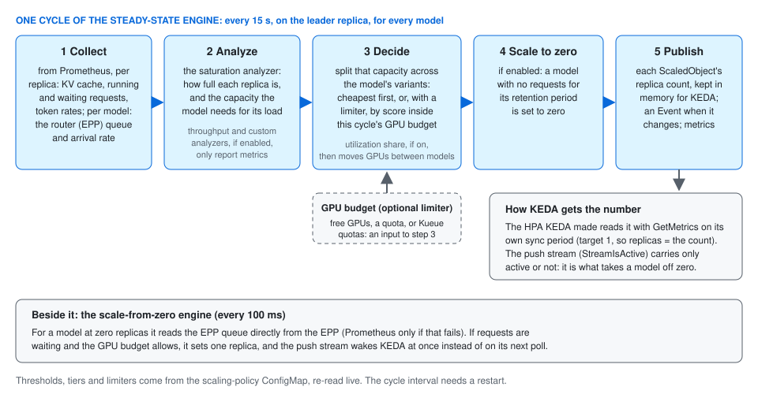

# How the scaling manager fits together

llm-scaling-manager decides how many replicas each LLM model server should run.
It reads how loaded the servers are, works out the replica count every model
needs, keeps the total inside a GPU budget if you set one, and hands the
number to KEDA. KEDA and the Kubernetes HPA do the actual scaling; the scaling
manager never changes a replica count itself.


## The parts, left to right

- **The serving path is llm-d's.** Clients send requests to a gateway. The
  EPP (endpoint picker, llm-d's router) chooses a replica for each request,
  and queues requests when every replica is busy. The model servers are vLLM
  or SGLang pods, run by a Deployment or a LeaderWorkerSet.
- **Prometheus** scrapes the model servers: KV-cache use, running and waiting
  requests, token counts, latency.
- **The scaling manager** is one Deployment, `wva-controller-manager`. Every
  15 seconds it reads those metrics, plus the EPP's queue, which it reads
  directly. The queue is also how a model parked at zero replicas is woken.
  Its settings (thresholds, tiers, limiters) live in the
  `wva-scaling-policy-config` ConfigMap and are re-read without a restart.
- **The GPU budget is optional.** Without one, each model is sized on its own.
  With one, every decision has to fit: the GPUs physically free on the
  cluster, a quota you declare, or a quota read from Kueue.
- **KEDA** asks the scaling manager for each variant's replica count over gRPC
  (the `wva-external-scaler` Service, port 9090), and the HPA that KEDA
  creates scales the workload to that number.

## The unit it scales: one ScaledObject per variant

A **model** is what clients ask for by name. A **variant** is one way of
serving it, such as one GPU type or one serving configuration. Each variant
is one KEDA ScaledObject plus the workload it scales. Variants whose triggers
name the same `modelID` are sized together, as one model.

```yaml
apiVersion: keda.sh/v1alpha1
kind: ScaledObject
metadata:
  name: llama-8b-h100
spec:
  scaleTargetRef:
    name: llama-8b-h100          # the Deployment (or LeaderWorkerSet) to scale
  minReplicaCount: 1
  maxReplicaCount: 8
  triggers:
    - type: external-push
      metadata:
        scalerAddress: wva-external-scaler.<controller-namespace>.svc.cluster.local:9090
        modelID: meta-llama/Llama-3.1-8B-Instruct
        variantCost: "10"        # relative cost: cheaper variants are filled first
```

You rarely write this by hand: `make scaledobjects-plan` lists the model
servers it finds and writes a plan to edit, and `make scaledobjects-apply`
creates the ScaledObjects. Creating the ScaledObject is the whole
registration; there is no other custom resource.

## One decision cycle



1. **Collect.** Per variant: KV-cache use, running and waiting requests,
   token rates, and the router's queue.
2. **Analyze.** How full each replica is (*saturation*), and how much
   capacity the model needs for its current load.
3. **Optimize.** Split that capacity across the model's variants, filling the
   cheapest (`variantCost`) first.
4. **Bound.** With a limiter, fit every model into the free GPUs or the quota.
   The [utilization-share optimizer](../well-lit-paths/utilization-share/)
   (experimental) can share one quota between models, lending one model's
   idle GPUs to another.
5. **Publish.** One replica count per ScaledObject, pushed to KEDA, with an
   Event on the ScaledObject when it changes.

How each step decides, in detail: [the steady-state
engine](steady-state-engine.md) and [modeling and
optimization](modeling-and-optimization.md).

## What gets installed

| Object | What it is for |
| --- | --- |
| Deployment `wva-controller-manager` | the scaling manager |
| Service `wva-external-scaler`, port 9090 | where KEDA asks for replica counts |
| Service `wva-controller-manager-metrics-service`, port 8443 | its own `wva_*` metrics, for Prometheus |
| ConfigMap `wva-scaling-policy-config` | thresholds, tiers, limiters; re-read live |
| ConfigMap `wva-manager-config` | Prometheus address and the cycle interval; changes need a restart |
| Roles and ClusterRoles | read pods, workloads, ScaledObjects, InferencePools, nodes and (optionally) Kueue queues; patch pods |

It has **no write access** to Deployments, ScaledObjects or HPAs. It patches
pods only to set annotations: the deletion cost that tells Kubernetes which
pod to remove first, and the marks of the utilization-share optimizer.

The common install is **namespace-scoped**: one scaling manager per namespace,
managing only the model servers there. A cluster admin runs a one-time setup
for the cluster-wide pieces first. Both steps are in [install in a
namespace](../guides/install-in-namespace/). A [cluster-wide
install](../guides/install-cluster-wide/) runs one controller for every
namespace. A cluster admin can also publish one policy for every controller
in the `wva-policy` namespace: [bound every install by real
GPUs](../guides/admin-gpu-bounding/).

## What it writes back

- **Metrics**, all named `wva_*`: desired and current replicas, saturation,
  GPU use, why a model is held back. The [monitoring
  page](../reference/monitoring.md) lists the ones that answer specific
  questions.
- **Events** on each ScaledObject: `ScaledUp`, `ScaledDown`, `ScaledToZero`,
  `ResourceConstrained`, `MetricsUnavailable`, and more.
- **Two log lines per model per cycle**, which say why it decided what it
  did: [the cycle log](../reference/cycle-log.md).

## Optional pieces

| Piece | What it does | Where |
| --- | --- | --- |
| Scale to zero | parks an idle model at zero replicas and wakes it when a request queues | [path](../well-lit-paths/scale-to-zero/) |
| Warm pool | keeps models loaded and asleep, and lends one to a variant while its own replica starts | [path](../well-lit-paths/warm-pool-bridge/) |
| GPU limiter | bounds every decision by the GPUs that are free (`gpu-inventory`; logged as `inventory`) | [path](../well-lit-paths/bound-by-gpus/) |
| Quota limiter | bounds each namespace, or the cluster, by a declared allowance | [path](../well-lit-paths/tenant-gpu-quotas/) |
| Kueue quotas | takes that allowance from Kueue's ClusterQueues (experimental) | [path](../well-lit-paths/kueue-bounded-quotas/) |
| Faster replica start | pre-pulls images, keeps weights and compile caches on each node | [preparing a workload](../reference/workload-preparation.md) |

## Next

- Install it: [in a namespace](../guides/install-in-namespace/).
- Pick the scenario that matches yours: [well-lit paths](../well-lit-paths/).
- Something does not scale: [troubleshooting](../reference/troubleshooting.md).
